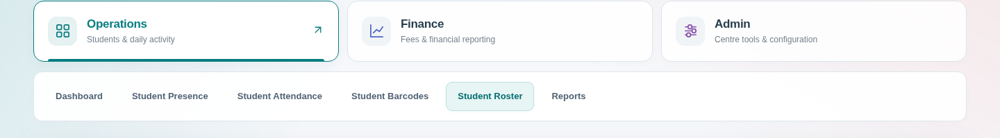
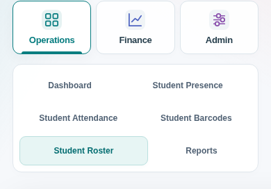

# Student navigation review

Operations, Finance and Admin remain visible as three workspace headings. Only the selected workspace's tools are shown. Each workspace remembers its last selected page for the current page session. Existing permissions control which pages and headings are available. Setup redirects and direct attendance navigation keep the correct heading selected.

The interface uses teal, indigo and purple accents, consistent SVG icons, a brief reveal transition, visible keyboard focus, arrow/Home/End navigation and a compact mobile layout. Reduced-motion preferences disable the animation.

For isolated local review, extract the source ZIP for `uat/student-navigation` and run **Start Staff Scheduling UAT.bat**. Keep the command window open. Open `http://127.0.0.1:8778/` on the same computer and select **Student Administration**. The launcher uses a separate synthetic database; production data is not connected. If the server window shows an error, resolve that error before opening the URL.

Verified in Chromium: exclusive options, page selection and remembered pages, keyboard navigation, mobile fit, permission-driven hiding and fallback, setup redirects, reduced motion and no browser exceptions. The existing service-worker checks pass. This branch is for review; it has not been merged into production `main`.
